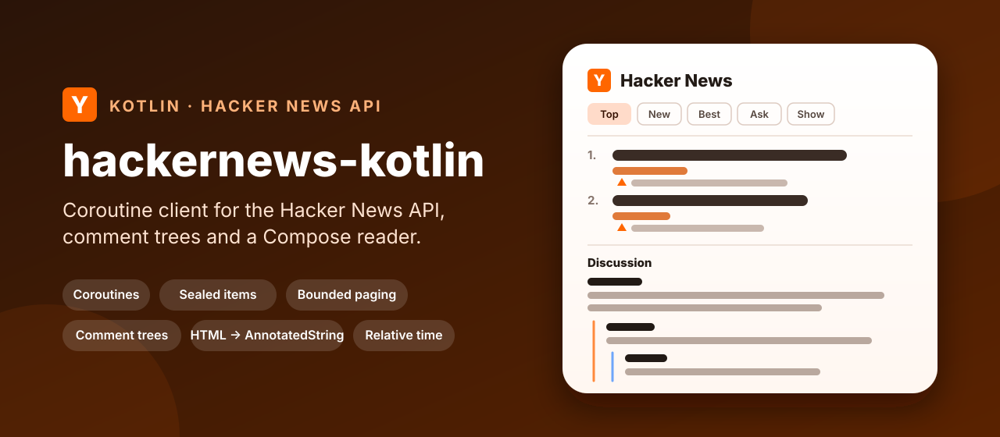
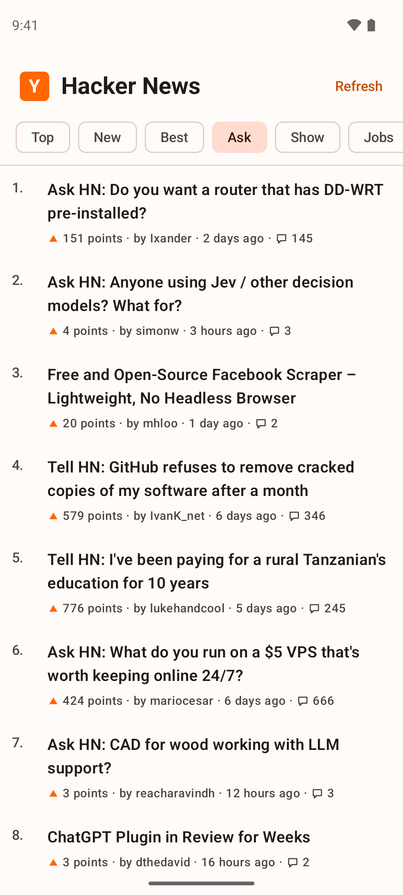

<p align="center">
  
</p>

<p align="center">
  <a href="https://github.com/halilozel1903/hackernews-kotlin/actions/workflows/ci.yml"></a>
  <a href="https://jitpack.io/#halilozel1903/hackernews-kotlin"></a>
  
  
  
  
  
  <a href="LICENSE"></a>
</p>

**hackernews-kotlin** is a Kotlin client for the [official Hacker News API](https://github.com/HackerNews/API). It loads the Top, New, Best, Ask, Show and Jobs lists, turns every item into a typed sealed `Item` (story, comment, job, poll, poll option), loads pages of items concurrently with bounded parallelism, builds comment trees with depth limits and sensible handling of deleted and dead comments, and parses Hacker News HTML into text and spans. The core is pure Kotlin/JVM (Ktor, kotlinx.serialization, coroutines), so it runs on Android, on the server and in tests. An optional Compose module turns comment HTML into an `AnnotatedString` with clickable links and keeps "3 hours ago" labels fresh, and the sample app is a full reader for phones and tablets.

```kotlin
val hn = HackerNewsClient()

val page = hn.stories(StoryList.Top, page = 0, pageSize = 30)   // ids, then 30 items, 8 at a time
val story = page.items.first() as Item.Story
story.title                                    // the live front page's top story
story.domain                                   // "github.com"
story.age()                                    // "3 hours ago"

val tree = hn.commentTree(story, CommentTreeOptions(maxDepth = 5))
tree.flatten().forEach { row -> println("  ".repeat(row.depth) + row.comment.by) }

val pg = hn.user("pg")!!
pg.karma                                       // his karma, live
```

## Screenshots

Captured live by CI on Android emulators. The sample app reads the real Hacker News API during the run: the stories, points, comments and the profile are whatever was on Hacker News at that moment. The app contains no bundled or fallback data; if the API cannot be reached, the screenshot job fails instead of capturing.

| Top stories | A story's comment tree | Ask HN | User profile |
| :---: | :---: | :---: | :---: |
|  |  |  |  |

**Tablet:** list and detail side by side, here the Top stories next to a story's discussion.


| Top, dark | Comments, dark | Ask HN, dark | Profile, dark |
| :---: | :---: | :---: | :---: |
|  |  |  |  |


## Features

- **Every list**: `topstories`, `newstories`, `beststories`, `askstories`, `showstories` and `jobstories` as `StoryList`, plus `item`, `user`, `maxitem` and `updates`.
- **Typed items**: a sealed `Item` with `Story`, `Comment`, `Job`, `Poll`, `PollOption` and `Unknown`, so a `when` covers everything. Stories know their `kind` (Link, Ask, Show, Launch, Text) and `domain`.
- **Concurrent paging**: a page loads its ids once and then its items concurrently, at most `maxConcurrency` requests at a time (8 by default), in ranked order. `pages()` is a cold `Flow` that keeps the ranking stable while you scroll.
- **Comment trees**: loaded level by level with bounded parallelism, limited by depth and by a comment budget. Deleted and dead comments are dropped, kept, or kept only when they have replies (the default), and replies of dropped comments are never requested. `flatten(collapsed)` gives rows for a `LazyColumn`.
- **Hacker News HTML**: `HnHtml.parse` handles `<p>` without closing tags, `<i>`, `<a href rel="nofollow">`, `<pre><code>`, `&#x27;`-style entities and `>` quotes, and returns text with link, italic, bold, code and quote spans.
- **Relative time**: "just now", "5 minutes ago", "3 hours ago", "2 years ago", or compact "5m", "3h", "2y".
- **Caching and de-duplication**: items and users are cached in memory for a few minutes (lists are always fresh), and identical requests running at the same time share one call.
- **Errors you can catch**: `HackerNewsException.Network`, `Http`, `NotFound` and `Decoding`. Missing items and users are `null`, as the API answers.
- **Pluggable HTTP**: Ktor with CIO by default; pass OkHttp, Android, Java or a `MockEngine`, a ready `HttpClient`, or your own `HackerNewsTransport`.
- **Compose helpers** (optional module): `HnHtmlText`, `toAnnotatedString()` with `LinkAnnotation.Url` links, `rememberRelativeTime` and `Modifier.commentIndent` with thread lines.
- **Explicit API**, unit tested with JSON fixtures shaped like the API's responses.

### API coverage

| Hacker News API | Function | Returns |
| --- | --- | --- |
| `GET /v0/topstories.json` (and `new`, `best`, `ask`, `show`, `job`) | `storyIds(StoryList.Top)` | `List<Long>` |
| Ids, then items | `stories(list, page, pageSize)`, `pages(list, pageSize)`, `page(list, ids, page)` | `StoryPage`, `Flow<StoryPage>` |
| `GET /v0/item/{id}.json` | `item(id)` | `Item?` |
| Many items | `items(ids, parallelism)` | `List<Item>` in the order of `ids` |
| `GET /v0/item/{id}.json`, recursively | `commentTree(item, options)`, `commentTree(id, options)` | `CommentTree` |
| `GET /v0/user/{id}.json` | `user(id)` | `User?` |
| A user's `submitted` ids | `submissions(user, limit)` | `List<Item>` |
| `GET /v0/maxitem.json` | `maxItem()` | `Long` |
| `GET /v0/updates.json` | `updates()` | `Updates` |

## Installation

Add JitPack to `settings.gradle.kts`:

```kotlin
dependencyResolutionManagement {
    repositories {
        google()
        mavenCentral()
        maven("https://jitpack.io")
    }
}
```

Then the dependency:

```kotlin
dependencies {
    implementation("com.github.halilozel1903.hackernews-kotlin:hackernews:1.0.0")

    // Optional: Jetpack Compose helpers (HTML as AnnotatedString, relative time, comment indentation).
    implementation("com.github.halilozel1903.hackernews-kotlin:hackernews-compose:1.0.0")

    // Optional: use OkHttp instead of Ktor's CIO engine.
    implementation("io.ktor:ktor-client-okhttp:3.6.0")
}
```

> The build is also set up for Maven Central (`io.github.halilozel1903:hackernews`) via the vanniktech publish plugin.

`hackernews` is a plain Kotlin/JVM library (JDK 17+), so it also works in server and desktop projects.

## Usage

**Create a client**

```kotlin
val hn = HackerNewsClient {
    engine = OkHttp.create()               // default: CIO
    maxConcurrency = 8                     // item requests in flight at once
    cacheSize = 1_000                      // items and users kept in memory; 0 turns caching off
    cacheTtl = 5.minutes
    requestTimeoutMillis = 20_000
    retries = 2                            // network errors and 5xx, with backoff
}
// ...
hn.close()
```

Create one client and share it; it is safe to use from many coroutines.

**Story lists and paging**

```kotlin
val ask = hn.stories(StoryList.Ask, page = 0, pageSize = 30)
ask.items                                  // up to 30 items, in ranked order
ask.firstRank                              // 1
ask.hasNext                                // true while more ids follow

// Infinite scrolling: ids load once, pages load as you collect.
hn.pages(StoryList.New, pageSize = 30).take(3).collect { page -> show(page.items) }

// Or keep the ids yourself and load any page.
val ids = hn.storyIds(StoryList.Best)
val third = hn.page(StoryList.Best, ids, page = 2)
```

Deleted and dead items are left out of pages unless you pass `includeRemoved = true`.

**Items**

```kotlin
when (val item = hn.item(8863)) {
    is Item.Story -> println("${item.title} (${item.domain}) ${item.score} points, ${item.descendants} comments")
    is Item.Comment -> println(item.body.text)
    is Item.Job -> println("Job: ${item.title}")
    is Item.Poll -> println("Poll with ${item.parts.size} options")
    is Item.PollOption -> println("${item.text}: ${item.score} votes")
    is Item.Unknown -> Unit
    null -> println("No such item")
}

// Your own bounded fan-out over any ids.
val items = hn.items(listOf(8863L, 121003L, 192327L), parallelism = 4)
```

**Comment trees**

```kotlin
val tree = hn.commentTree(
    story,
    CommentTreeOptions(
        maxDepth = 6,                          // levels to load
        maxComments = 300,                     // request budget, breadth first
        deleted = RemovedComments.KeepIfReplies,
        dead = RemovedComments.Drop,
    ),
)
tree.size                                  // comments in the tree
tree.depth                                 // deepest level + 1
tree.isComplete                            // false when limits left replies unloaded
tree.find(commentId)?.replies

// Rows for a LazyColumn; collapsed comments hide their replies.
val rows = tree.flatten(collapsed = setOf(collapsedId))
rows.first().hiddenReplies
```

Already have the items? `CommentTreeBuilder.build(parentId, kids, itemsById, options)` builds the same tree without requests.

**Users**

```kotlin
val user = hn.user("dang") ?: return       // null when there is no such user
user.karma
user.age()                                 // "15 years ago"
user.aboutText?.text                       // about, as plain text
hn.submissions(user, limit = 20)           // newest stories and comments
```

**Hacker News HTML and time**

```kotlin
val text = HnHtml.parse(comment.text.orEmpty())
text.text                                  // paragraphs separated by blank lines, entities decoded
text.links.map { it.url }                  // every link
text.spans                                 // Link, Italic, Bold, Code (inline or block), Quote

HnHtml.decodeEntities("I&#x27;m &quot;here&quot;")   // I'm "here"

RelativeTime.format(item.time)             // "3 hours ago"
RelativeTime.format(item.time, style = RelativeTime.Style.Compact)   // "3h"
```

**Errors**

```kotlin
try {
    hn.stories(StoryList.Top)
} catch (e: HackerNewsException.Network) {
    // offline or timed out
} catch (e: HackerNewsException) {
    // Http (with status), NotFound or Decoding
}
```

**Testing your code with fixtures**

```kotlin
val hn = HackerNewsClient {
    // fixtures/topstories.json, fixtures/item/8863.json, fixtures/user/pg.json, ...
    transport = FixtureTransport { path -> javaClass.getResource("/fixtures/$path")?.readText() }
}
```

Missing item and user files answer `null`, like the real API. Or pass a Ktor `MockEngine` as `engine`.

### Compose helpers

```kotlin
// A comment with paragraphs, italics, code blocks, quotes and clickable links.
HnHtmlText(comment.text.orEmpty(), style = MaterialTheme.typography.bodyMedium)

// Or build the AnnotatedString yourself.
val annotated = HnHtml.parse(html).toAnnotatedString(HnTextStyle.fromTheme())

// "5 minutes ago", refreshed when the text changes.
val age by rememberRelativeTime(item.time)

// Indentation with one colored thread line per level.
Column(Modifier.commentIndent(row.depth)) { /* the comment */ }
```

## Sample app

The `sample` module is a Hacker News reader: Top, New, Best, Ask, Show and Jobs with infinite scrolling, a story screen with the text of Ask and Show posts and a collapsible comment tree (OP highlighted, thread lines, deleted and flagged placeholders), and user profiles with karma, about text and recent submissions. On tablets the list and the story sit side by side. It reads the live API only, with OkHttp as the Ktor engine.

For screenshots it opens a fixed screen from an intent extra (used by `scripts/screenshots.sh`):

```bash
./gradlew :sample:installDebug
adb shell am start -n io.github.halilozel1903.hackernews.sample/.MainActivity --es scene story
```

`scene` is one of `top` (Top stories), `story` (the first front page story with at least 15 comments, and its comment tree), `ask` (Ask HN), `user` (pg's profile) or `tablet` (Top stories and that story's discussion side by side). Every scene loads live data through the same client as a normal launch and logs `SCENE_READY` once it has loaded, or `SCENE_FAILED` when a request fails. CI captures the phone scenes on a Pixel 7 and `tablet` on a Pixel Tablet in landscape, in light and dark mode, and fails instead of capturing when a scene fails, does not finish loading, misses its expected text or is blank.

## Be nice to the API

The Hacker News API is free and has no documented rate limit, but every item is its own request. Keep `maxConcurrency` modest, use `maxDepth` and `maxComments` for big threads, and let the client's cache absorb repeated reads.

## Project structure

| Module | What it is |
| --- | --- |
| `hackernews` | Pure Kotlin/JVM: `HackerNewsClient`, the sealed `Item` model, paging, comment trees, `HnHtml`, `RelativeTime`, `FixtureTransport`. Published as `hackernews` |
| `hackernews-compose` | Jetpack Compose: `HnHtmlText`, `toAnnotatedString`, `rememberRelativeTime`, `Modifier.commentIndent`. Published as `hackernews-compose` |
| `sample` | The reader app for phones and tablets, with live screenshot scenes |

## Tech stack

Kotlin 2.4 · Ktor 3.6 (CIO, OkHttp) · kotlinx.serialization · kotlinx.coroutines · AGP 9.4 with built-in Kotlin · Gradle 9.6 · Jetpack Compose (BOM 2026.09) · Material 3 · GitHub Actions with Android emulators

## Legal

Hacker News is run by Y Combinator. This project is not affiliated with or endorsed by Y Combinator. Data comes from the [official Hacker News API](https://github.com/HackerNews/API); the screenshots show stories, comments and profiles as they were on Hacker News when CI captured them, and their text belongs to its authors.

## License

MIT. See [LICENSE](LICENSE).
